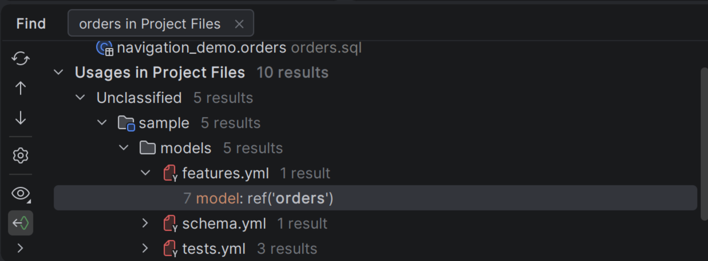

# intellij-dbt user guide

intellij-dbt adds Go to Declaration and Find Usages for dbt projects in IntelliJ IDEA
Community Edition. You can follow references between models, sources, macros, variables,
tests, documentation and other dbt resources.

## Install and open a project

1. Use IntelliJ IDEA Community Edition 2026.2.
2. Open **Settings → Plugins**, select the gear menu and choose **Install Plugin from Disk**.
3. Select the intellij-dbt plugin ZIP and restart the IDE if prompted.
4. Keep the bundled **YAML** plugin enabled. For Python models, also install and enable
   the free **Python Community Edition** plugin.
5. Open a directory containing `dbt_project.yml`. An IDE project can contain several
   dbt project directories.

To build a plugin ZIP locally, follow the [development instructions](../README.md#development).

SQL navigation works when SQL files are opened as plain text. Ultimate and Database
Tools are optional. Source navigation works without a dbt installation, warehouse
credentials or a network connection.

## Follow a reference

Use **Ctrl+Click** or **Go to Declaration** on a referenced name. For example,
click `orders` in `ref('orders')` to open `models/orders.sql`.

Open a definition and invoke **Find Usages** to list its references. Select a result
to inspect or open it.

The [complete example project](../README.md#example-project) shows the files and
references together.

## Open properties and dependencies

Right-click inside a resource file and choose:

- **dbt Properties** to open its YAML properties. Choose a file when several files
  describe the resource.
- **dbt Dependencies** to browse resources it uses and resources that use it.

**Uses** lists resources the current resource depends on. **Used by** lists resources
that depend on it. Click a resource name to open its definition. An indented
`file:line` entry opens the reference; `events.sql:4` opens line 4 of `events.sql`.
Multiple references to one resource appear beneath the same name.

The [icon legend](icons.md) explains each resource type. Screenshots show an expanded
version of the example project.

## Choose a guide

| Guide | What you can do |
| --- | --- |
| [Navigation](navigation.md) | Follow dbt, Jinja, YAML, SQL and Python references |
| [Configuration](configuration.md) | Select a dbt version, profile, local overrides or metadata files |
| [Icon legend](icons.md) | Identify resources by their icons |
| [Troubleshooting and limits](troubleshooting.md) | Understand missing or ambiguous targets and unsupported operations |

The plugin provides navigation and reference search. Run dbt and warehouse queries
with your usual tools. SQL highlighting, completion, data previews and Rename
refactoring are outside the plugin's features.
