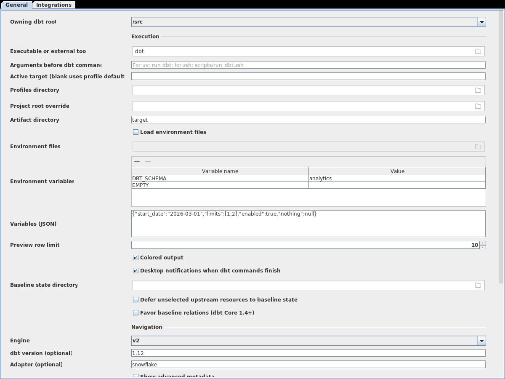
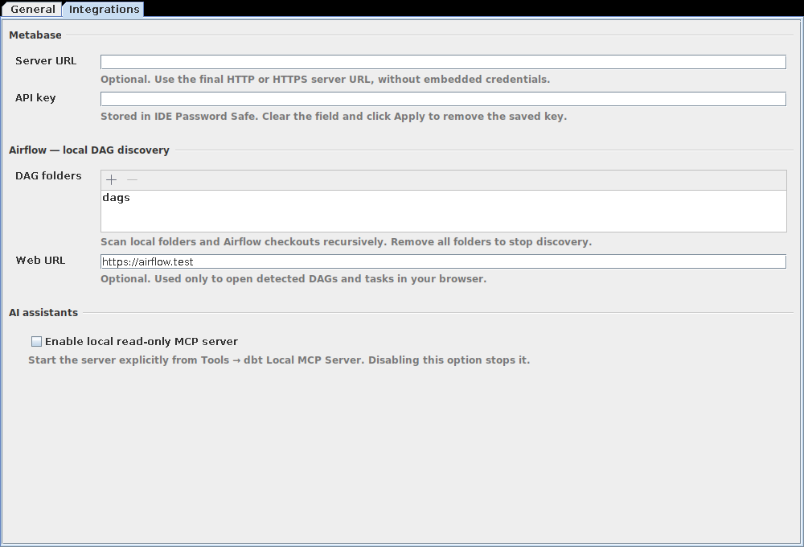

# Configuration

[User guide](getting_started.md)

Configure the plugin in **Settings → dbt Workspace**. Settings are saved with the
IntelliJ project. Most navigation needs no settings.

## Settings → dbt Workspace

The page has two tabs: **General** for navigation, execution, formatting and lineage,
and **Integrations** for Metabase, Airflow and the local MCP server. **Apply** saves
both tabs. On **General**, choose **Owning dbt root** first: navigation, execution,
environment, formatter and baseline settings apply to that dbt project only.
The page groups **Execution**, **Navigation**, **Formatting** and **Lineage**.
Select **Show advanced metadata** under Navigation for explicit metadata paths and
local builtin definitions. Lineage settings apply across dbt roots.



### Navigation settings

Paths below are absolute or relative to the owning dbt root, except **Manifest file
(optional)**, which resolves relative to the execution project.

| Setting | Default and effect |
| --- | --- |
| **Engine** | `core` or `v2`; defaults to `core`. See [Engine and version](#engine-and-version). |
| **dbt version (optional)** | Blank uses `require-dbt-version` from `dbt_project.yml`, or Core 1.10. |
| **Adapter (optional)** | Blank uses the selected profile output type. See [Profiles and adapters](#profiles-and-adapters). |
| **Profiles file for navigation (optional)** | Blank uses `profiles.yml` in the resolved profiles directory. Commands use **Profiles directory**. |
| **Variables (JSON)** | JSON object of dbt variable overrides. Blank uses project defaults. See [Variable overrides](#variable-overrides). |
| **Environment variables** | Name/value overrides for dbt commands and formatters. Empty values are allowed. See [Environment files](#environment-files). |
| **Local builtin definitions** | Maps builtin names to local SQL or Python source files. See [Local builtin definitions](#local-builtin-definitions). |
| **Catalog file (optional)** | Blank uses `catalog.json` in **Artifact directory**. |
| **State manifest for navigation (optional)** | Manifest used for state-related navigation. Commands use **Baseline state directory**. |
| **Information Schema v1 directory (optional)** | Selected dbt v2 `v1/` directory. See [dbt v2 Information Schema](#dbt-v2-information-schema). |

### Engine and version

The default is dbt Core 1.10. When `require-dbt-version` is set in `dbt_project.yml`,
the plugin uses the lowest stable version allowed by all its bounds, including the
patch number. Bounds can be a comma-separated string or a list, in any order.
Invalid, contradictory or prerelease bounds leave version-dependent features
disabled. A range with only upper bounds establishes no minimum feature support.
Set **dbt version (optional)** to override this; for example, enter `1.12`
and choose `core` in **Engine**.

A minor version such as `1.10` uses that series' supported patch level. Set a full
version such as `1.10.5` for patch-specific behavior.

| Feature | Required version or setting |
| --- | --- |
| Model versions and model contracts | Core 1.5+ |
| Semantic models and Mesh source dependencies | Core 1.6+ |
| Saved queries | Core 1.7+ |
| Unit tests and `data_tests` | Core 1.8+ |
| Generic-test `arguments` mapping | Core 1.10.5+ |
| UDF resources | Core 1.11+ |
| `vars.yml`, model-embedded semantics, UDF overloads, JavaScript UDFs and string `selector:` terms | Core 1.12+ |
| Checks and Information Schema v1 | **Engine** set to `v2` |

### Profiles and adapters

For example, set **Profiles file for navigation (optional)** to `profiles.yml`,
**Active target (blank uses profile default)** to `dev`, and **Adapter (optional)**
to `postgres`. Click **Apply**.

The selected profile output defines fields such as `target.schema`. The adapter
narrows dispatch and function targets; without it, navigation can offer several
candidates.

| UDF language | Supported adapters |
| --- | --- |
| Python | Snowflake, BigQuery, Databricks |
| JavaScript | Snowflake, BigQuery |

UDF overloads are supported on Snowflake and Postgres.

### Variable overrides

In **Variables (JSON)**, enter a JSON object and click **Apply**. For example:

```json
{"start_date": "2026-03-01", "regions": ["US", "CA"], "include_archived": false}
```

The plugin passes these values to dbt commands with `--vars`, preserving strings,
numbers, booleans, lists, objects and `null`. They override project defaults for
editor navigation. **Apply** requires an object; lists and scalar values are rejected.
Blank uses project defaults. Each owning dbt root has its own overrides.

Go to Declaration for an overridden variable or environment name opens a read-only
list of names labeled **IntelliJ settings**. Values are edited only in this settings
page and are not included in that list.

Select the active target through **Active target (blank uses profile default)**.
Use the [Runner and native Run configuration controls](workspace.md#run-configurations)
for selection, exclusion and named selectors. Standard `selectors.yml` definitions
support [selector navigation](navigation.md#selectors).

### Local builtin definitions

In **Local builtin definitions**, click **Add** and enter a **Builtin name** and
**Local source file**, then click **Apply**. For example:

| Builtin name | Local source file |
| --- | --- |
| `adapter.get_relation` | `vendor/adapter.py` |
| `run_query` | `vendor/core_macros.sql` |

Navigation opens the local definition instead of the selected dbt version's
reference documentation. Select a row and click **Remove** to delete a mapping.

SQL mappings name files containing macros; Python mappings name files containing
functions and need [Python support](installation.md#requirements). Missing
definitions fall back to documentation.

### Local metadata

Select metadata for resources or columns without local source. A manifest records
dbt resources and dependencies; a catalog adds database column information. Local
source definitions take precedence. Metadata targets are labeled, including stale
ones, and open read-only.

| Metadata | Setting | Supported selection |
| --- | --- | --- |
| Manifest JSON | **Manifest file (optional)** | Schema versions 9–12 |
| Catalog JSON | **Catalog file (optional)** | Schema version 1; fresh column metadata |
| State manifest | **State manifest for navigation (optional)** | Manifest for state-related resource references |
| Information Schema Parquet | **Information Schema v1 directory (optional)** | dbt v2 `v1/` directory; resource, column and dependency metadata |

For example, enter `target/manifest.json` in **Manifest file (optional)**,
`target/catalog.json` in **Catalog file (optional)**, and `state/manifest.json` in
**State manifest for navigation (optional)**, then click **Apply**.

The manifest and `catalog.json` in the [Artifact directory](#execution-settings)
load automatically. If metadata seems missing, check the paths, the supported
versions above, and whether the metadata was generated for the current project and
target.

### dbt v2 Information Schema

Requires **Engine** set to `v2` and, if set in `dbt_project.yml`, `info_schema.version: 1`.

Choose `v2` in **Engine** and enter `target/info_schema/v1` in
**Information Schema v1 directory (optional)**, then click **Apply**.

Files include resources (`dbt.models.parquet`), columns (`dbt.node_columns.parquet`)
and dependencies (`dbt.edges.parquet`). Each file is limited to 100,000 rows and
64 MiB, and must be uncompressed or use Snappy, Gzip, Zstd or LZ4 raw compression.
For example, `ref('remote_orders')` opens metadata when local source is absent.
Resources with a missing or old `ingested_at` are marked stale; their columns and
dependencies are ignored, as are those of resources with unsaved source edits.
See dbt's [Information Schema file layout](https://docs.getdbt.com/docs/build/dbt-information-schema)
and [table definitions](https://docs.getdbt.com/reference/info-schema?version=2).

### Execution settings

| Setting | Default and effect |
| --- | --- |
| **Executable or external tool** | `dbt`; a project `.venv` or `venv` is discovered first. A command name, executable or wrapper script is accepted. See [Executables and wrapper scripts](#executables-and-wrapper-scripts). |
| **Arguments before dbt command** | Empty. Arguments placed before the dbt command; quote arguments containing spaces. |
| **Load environment files** | Enabled. Clear to skip environment files. |
| **Environment files** | Blank uses `.env` when **Load environment files** is enabled. See [Environment files](#environment-files). |
| **Project root override** | Blank uses the owning directory containing `dbt_project.yml`. Commands run in this directory. |
| **Profiles directory** | Blank uses `DBT_PROFILES_DIR`, a project-local `profiles.yml`, then `~/.dbt`. Choose the directory containing `profiles.yml`. |
| **Artifact directory** | `target`. Commands write artifacts here. |
| **Manifest file (optional)** | Blank uses `manifest.json` in the artifact directory. Choose a file, or enter a path relative to the execution project. |
| **Active target (blank uses profile default)** | Blank uses the selected profile's default target. |
| **Preview row limit** | 10; accepts 1–1000. |
| **Colored output** | Enabled. |
| **Desktop notifications when dbt commands finish** | Enabled. Notifications appear only while the IDE window is inactive and require **Settings → Appearance & Behavior → Notifications → Enable system notifications**. |

Commands run with `DBT_TARGET_PATH` set from **Artifact directory**,
`DBT_PROFILES_DIR` from **Profiles directory** (this takes precedence over a value
from environment files) and `--target` from **Active target**. A discovered local
virtual environment is prepended to `PATH`. A [dbt Run configuration](workspace.md#run-configurations)
can override the executable, prefix arguments, profiles directory and target.

### Executables and wrapper scripts

Every command, including tests, previews, documentation and selection resolution,
is started as:

```text
<executable> <arguments before dbt command> <dbt command> <dbt options>
```

| Executable or external tool | Arguments before dbt command | Example invocation |
| --- | --- | --- |
| `dbt` | *(empty)* | `dbt test …` |
| `uv` | `run dbt` | `uv run dbt test …` |
| `poetry` | `run dbt` | `poetry run dbt test …` |
| `zsh` | `scripts/run_dbt.zsh analytics` | `zsh scripts/run_dbt.zsh analytics test …` |
| `bash` | `"scripts/dbt wrapper.sh"` | `bash "scripts/dbt wrapper.sh" test …` |

The tool must accept the dbt command and options appended by the plugin. A wrapper
must forward them (for example `dbt "$@"`), preserve dbt's exit code, and leave its
output and artifacts available. The plugin does not validate third-party tool syntax.

Executable paths containing `/` or `\` resolve relative to the command directory.
Prefix arguments are split with quoted strings kept together. Shell substitutions,
pipes, `$VAR` and `~` are not expanded; put shell logic in the wrapper script.

### Environment files

dbt commands and SQL formatters load `.env` from the owning dbt root (the directory
containing that project's `dbt_project.yml`):

```dotenv
# .env
ATHENA_WORK_GROUP=my-workgroup
DBT_SCHEMA=analytics
```

Reference a variable in `profiles.yml`; dbt reads it when the command runs, here
falling back to `primary`:

```yaml
work_group: "{{ env_var('ATHENA_WORK_GROUP', 'primary') }}"
```

To use other files, enter semicolon-separated paths in **Environment files**, such as
`.env; .env.local`, or choose a file with the browse button, then click **Apply**.
Paths are absolute or relative to the owning dbt root, even when **Project root
override** points elsewhere. A nonempty **Environment files** setting replaces
`.env`. Clear **Load environment files** and click **Apply** to disable loading.

To set an override directly, click **Add** in **Environment variables**, enter a
**Variable name** and **Value**, then click **Apply**. For example, use
`ATHENA_WORK_GROUP` and `my-workgroup`. An empty value is passed as an empty string;
select the row and click **Remove** to stop overriding it. Values are saved with
the IntelliJ project settings.

Commands inherit the IDE's environment. Files override inherited values in their
listed order; the last assignment wins. Values in **Environment variables** override files.
Each command reads the current file contents. Missing files and invalid assignments
are skipped.

Supported syntax: `export KEY=value`, empty values, single or double quotes, and
comments. An unquoted inline comment starts with whitespace followed by `#`; quoted
`#` is literal. Double quotes support `\n`, `\r`, `\t`, `\"` and `\\`. Multiline
values, `$VAR` substitution and shell commands are not evaluated.

### Baseline state and deferral

Set **Baseline state directory** to a separate directory containing `manifest.json`
(schema versions 9–12). It supplies [baseline comparison](workspace.md#review-a-selection-and-compare-a-baseline)
and command state. It must not overlap **Artifact directory**, including through
symbolic links. Baselines larger than 50 MB or 50,000 resources cannot be compared.
**State manifest for navigation (optional)** is separate and only supplies navigation targets.

| Option | Effect and prerequisite |
| --- | --- |
| **Defer unselected upstream resources to baseline state** | Adds `--defer --state <directory>`. Requires a valid baseline and dbt Core. |
| **Favor baseline relations (dbt Core 1.4+)** | Adds `--favor-state`. Requires deferral and Core 1.4+. Without it, dbt uses a relation that already exists in the active target instead of the baseline one. |

Both options are off by default and unavailable for **Engine** set to `v2`. Set the
[engine and version](#engine-and-version) to match your executable.

### SQL formatter

| Setting | Effect |
| --- | --- |
| **SQL formatter** | `sqlfmt` (default) or `sqlfluff`. SQLFluff is required for SQL inspection. |
| **Formatter executable (optional)** | Blank disables formatting and SQL inspection. Enter a command name or choose an executable. Relative paths resolve from the execution root. |
| **Format dbt SQL on save** | Off by default. Formats supported dbt SQL files in the background when saved. |

The formatter runs in the execution directory with the project's environment, so
the project's SQLFluff configuration and templater must work there. Runs longer
than 60 seconds are canceled. See [SQL linting and formatting](editing.md#sql-linting-and-formatting).

### Lineage settings

These apply to the [Lineage tab](workspace.md#lineage) of the IDE project.

| Setting | Default and choices |
| --- | --- |
| **Upstream levels to show** | Dependency levels before the focused resource; 1 shows direct inputs. Default 5; accepts 1–20. |
| **Downstream levels to show** | Dependent levels after the focused resource; 1 shows direct consumers. Default 5; accepts 1–20. |
| **Layout direction** | `LR` (left to right, default), `TB` (top to bottom), `RL` (right to left) or `BT` (bottom to top). |

### Metabase connection

On the **Integrations** tab:

| Setting | Effect |
| --- | --- |
| **Server URL** | Optional base HTTP or HTTPS URL without embedded credentials. Use HTTPS for a remote server. Redirects are refused, so enter the final server URL. |
| **API key** | Shown masked and stored in IDE Password Safe. **Apply** saves it outside project files; clear the field and click **Apply** to remove it. |

The API key needs read access to questions, databases and their table/field
metadata, and any dashboards you want to see. Applying these settings clears cached
Metabase data. See [Find downstream consumers](integrations.md#find-downstream-consumers).

### Airflow DAG discovery

On the **Integrations** tab, under **Airflow — local DAG discovery**:

| Setting | Effect |
| --- | --- |
| **DAG folders** | Use the **Add folder…** (+) toolbar icon to add DAG folders or complete Airflow checkouts, including folders outside the IDE project. Saved settings may also hold workspace-relative paths. **Remove folder** (−) removes the selected folders. Remove all folders to stop discovery. |
| **Web URL** | Optional HTTP or HTTPS web URL without embedded credentials. Enables browser links to detected DAGs and tasks. |

See [Inspect Airflow context](integrations.md#inspect-airflow-context).

For example, add a local `dags` folder and enter `https://airflow.test` as the
**Web URL** to enable browser links for discovered tasks:



### Local MCP server

On the **Integrations** tab, under **AI assistants**, select **Enable local read-only
MCP server** and click **Apply**. The option is off by default; the
server starts only when you click **Start**. Clearing the option stops it. See
[Connect an AI assistant](integrations.md#connect-an-ai-assistant-with-the-local-mcp-server).
