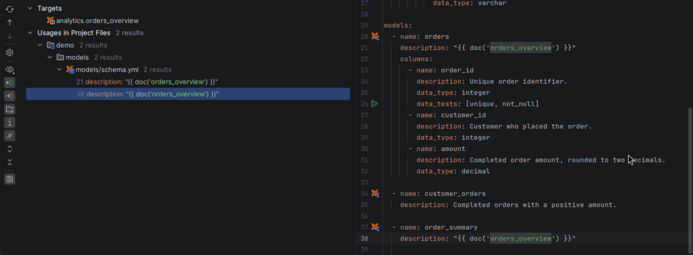

# Navigation

[User guide](getting_started.md) · [Editing](editor.md) · [Configuration](configuration.md) · [Icon legend](icons.md) · [Troubleshooting](troubleshooting.md)

dbt references connect model code, YAML properties, macros, tests and documentation.
Targets use the owning project, package and model version. See
[local metadata and v2 checks](configuration.md#local-metadata) or
[troubleshooting](troubleshooting.md) for missing or ambiguous targets.

## Gutter markers

Click the dbt icon beside a resource or declaration to open YAML properties, source
definitions, or **Uses** / **Used by** and their reference locations. Macro, test and
docs declarations show callers; unit tests link to their model and fixture files.

Markers also identify references with multiple definitions or metadata-only targets;
tooltips show ambiguity and staleness. Targets on the same line share one popup.

The **dbt Dependencies** popup groups dependencies under **Uses** and consumers
under **Used by**. Choose a resource to open its declaration or a `file:line`
entry to open the corresponding reference.


## CTE structure and dependency hierarchy

For a dbt SQL model, **Structure** and the **File Structure** popup list CTE
(named WITH-query) definitions, including nested CTEs. Select an entry to open its
definition. Browsing this outline runs no query.

**Navigate → Call Hierarchy** on a model or column opens **Upstream dependencies**
and **Downstream consumers** in the native Hierarchy window. Model entries follow
resource dependencies. Column entries distinguish value, join and filter inputs,
and mark incomplete origins. Cycles stop expanding when they revisit a resource
already present in that branch. Existing Find Usages continues to show concrete
reference locations.

**Navigate → Related Symbol** on a resource includes detected Airflow DAG/task
definitions. Resource Quick Documentation includes their detected selection,
exclusions and schedule. See [Airflow context](integrations.md#inspect-airflow-context)
for discovery boundaries.

## Where references work

| Location | References you can follow |
| --- | --- |
| SQL models, macros, analyses, tests, snapshots and supported function/check bodies | dbt calls, Jinja names, applicable builtin context and SQL names |
| Resource descriptions in YAML | Docs blocks, variables and environment keys |
| Properties and configuration YAML | Variables, environment keys and applicable context fields |
| Hooks, test arguments and SQL expression fields | Applicable dbt calls, including relationship targets and snapshot relations |
| Unit-test and Semantic Layer expressions | Applicable resource and semantic references |
| `dbt_project.yml` outside hooks | Project context; variable navigation depends on version and explicit settings |
| Selected profiles and `packages.yml` | Environment keys and explicitly configured runtime variables |
| `dependencies.yml` and `package-lock.yml` | Declarative dependency references |
| Python models | Supported `dbt` API calls |

Quoted and multiline YAML values work in these locations.

## Models, seeds, snapshots and sources

```sql
select *
from {{ ref('orders') }}
join {{ source('raw', 'events') }} e on true
```

Click `orders` to open the model; `ref()` also targets seeds and snapshots.
In `source()`, `raw` opens the source and `events` its table. Use YAML names,
even when `identifier` sets a different warehouse name.

YAML properties link to source files; **dbt Properties** opens YAML from source.


### Model versions

In `models/schema.yml`:

```yaml
models:
  - name: orders
    latest_version: 2
    versions:
      - v: 1
        defined_in: orders_previous
      - v: 2
```

```jinja
{{ ref('orders') }}                  {# opens orders_v2.sql #}
{{ ref('orders', v=1) }}             {# opens orders_previous.sql #}
{{ ref('finance', 'orders', v=2) }}  {# opens the finance version #}
```

Unversioned references use `latest_version`; `defined_in` names the source file.

### Packages and other projects

Use the package's dbt project name: `ref('finance', 'orders')` or
`finance.format_amount()`. The package must be installed locally.

Cross-project references require a `dependencies.yml` project dependency and a public
target. Dependency entries open installed sources; versions/revisions can open
`package-lock.yml`.

## Macros and Jinja names

```jinja

  {{ value * 2 }}



{{ double(value=2) }}
{{ ref(model_name) }}
{{ var('start_' ~ 'date') }}
```

Click `double` for the macro or `value` for its parameter; Find Usages lists callers.
Constants such as `model_name` and `'start_' ~ 'date'` also navigate.

Assignments, loop variables, macro/call-block parameters, `with` bindings, captures
and namespace attributes resolve within their scope. Local names can shadow dbt context.
Simple wrappers connect literal arguments to inner `ref()`, `source()`, `var()`,
`doc()` or `function()` calls.

Jinja comments and raw blocks are ignored; active Jinja in SQL comments counts.

## Variables

In `dbt_project.yml`:

```yaml
name: analytics
vars:
  region: us
  start_date: '2026-01-01'
  analytics:
    start_date: '2026-02-01'
  options:
    include_archived: false
```

```jinja
{{ var('start_date') }}
{{ var('region', 'eu') }}
{{ var('options')['include_archived'] }}
```

`start_date` opens the project-scoped definition. The fallback `'eu'` has no target.
`options` opens the dictionary; its members are not separate dbt variables.

Package macros use the calling node's project variables. `builtins.var`,
`builtins.ref` and `builtins.source` bypass same-named user macros.

For run-specific variables, environment keys and `vars.yml`, see
[local overrides](configuration.md#variables-and-environment).

## Documentation blocks

```yaml
models:
  - name: orders
    description: "{{ doc('orders_description') }}"
```

Click `orders_description` to open its `` block; Find Usages lists referencing
descriptions. `doc()` navigation works only in resource descriptions, not SQL or
`config.meta.description`.



## Data tests and unit tests

```yaml
models:
  - name: orders
    columns:
      - name: customer_id
        data_tests:
          - relationships:
              arguments:
                to: "ref('customers')"
                field: customer_id
unit_tests:
  - name: orders_example
    model: orders
    given:
      - input: ref('customers')
        format: csv
        fixture: customers_input
    expect:
      format: csv
      fixture: orders_expected
```

Custom tests open their `` block; builtins open documentation.
Named arguments open parameters; relationship targets and columns navigate separately.

Unit-test models, inputs and macro/variable overrides open their declarations.
CSV/SQL fixtures open files under `<test-path>/fixtures/`; Find Usages lists their
references. Inline rows have no file targets. Supported syntax depends on the
[dbt version](configuration.md#engine-and-version).

## Configuration, profiles and dispatch

```jinja
{{ config(materialized='audit', schema='reporting') }}
{{ config.get('materialized') }}
{{ adapter.dispatch('format_amount', 'finance')(amount) }}
```

Configuration keys open project, folder, resource-property or inline settings.
Schema, alias and database settings can open `generate_*_name` macros; custom
materializations open their definitions.

Dispatch uses `macro_namespace`, `search_order` and the selected adapter, with default
fallbacks and Redshift's Postgres inheritance. [Select a profile, target and adapter](configuration.md#profiles-and-adapters)
to resolve dispatch and fields such as `target.schema`.

## Semantic Layer and resource ownership

```jinja
{{ Dimension('customer__country') }}
{{ Metric('revenue') }}
```

Standalone `semantic_models` and model-embedded definitions work in supported dbt
versions. Entity paths, dimensions, measures, metrics, inputs, expression aliases,
saved-query metrics and export owners open their definitions.
Time-spine `standard_granularity_column` opens the model column; exposure dependencies
and group names open their resources.

## User-defined functions

```jinja
{{ function('hash_customer') }}(customer_id)
```

Click `hash_customer` to open its source; **dbt Properties** opens YAML for SQL,
Python and JavaScript bodies. `overloads[].defined_in` opens additional bodies;
SQL argument names can open YAML declarations. Support depends on
[version, adapter and language](configuration.md#function-compatibility).

## SQL names and columns

```sql
with recent_orders as (
  select order_id from {{ ref('orders') }}
)
select r.order_id as id from recent_orders r order by id
```

Click `recent_orders` for the CTE, `r` for its alias, or `id` in `order by` for the
selected expression. Columns open YAML declarations, simple model projections or
selected local metadata. Ambiguous joins offer several targets.

## Selectors

In `selectors.yml`:

```yaml
selectors:
  - name: nightly
    definition: '+orders+'
  - name: finance_sources
    definition:
      method: source
      value: raw.*
```

Selector references open matching resources; wildcards can offer several targets.
Named selectors, nested unions/intersections/exclusions and graph operators expose
individual references. Inheritance uses YAML `method: selector`, or string
`selector:nightly` terms in Core 1.12+.

Configured selection files support `select`, `exclude` and `selector` navigation;
`state:` terms need a [state manifest](configuration.md#local-metadata).

## Python models

With [Python support](installation.md) available:

```python
def model(dbt, session):
    orders = dbt.ref("orders", v=2)
    events = dbt.source("raw", "events")
    dbt.config(materialized="table")
    return orders
```

Calls must use the model's `dbt` parameter or a local alias of it.

## Information Schema references

In a dbt v2 check, Information Schema views and known columns open their metadata:

```sql
select name
from {{ info_schema('models') }}
where name = 'orders'
```

The view and known columns can open builtin documentation when local metadata is
unavailable. A literal model name such as `orders` can open the model when its
condition identifies a unique resource. See
[Information Schema configuration](configuration.md#dbt-v2-information-schema-and-checks)
for the required version and metadata directory.
