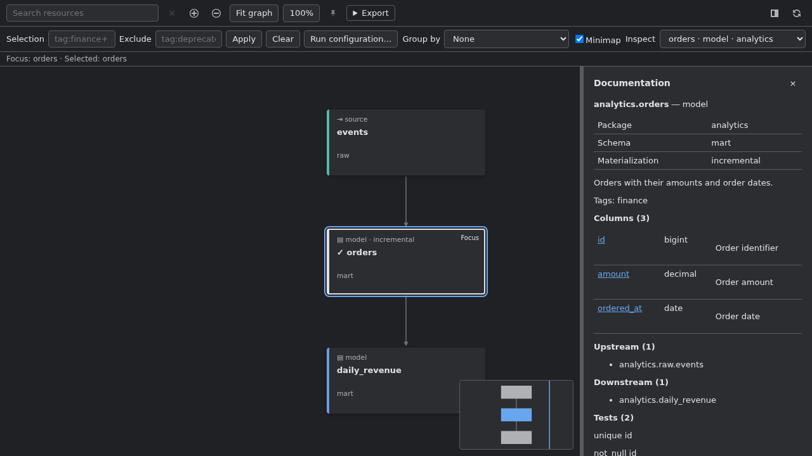
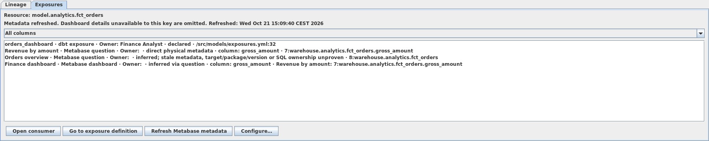
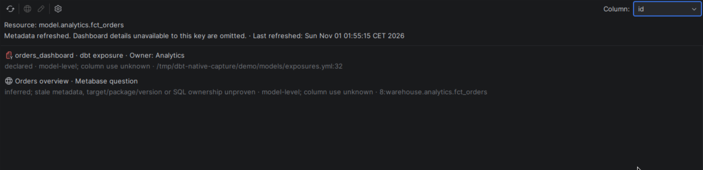
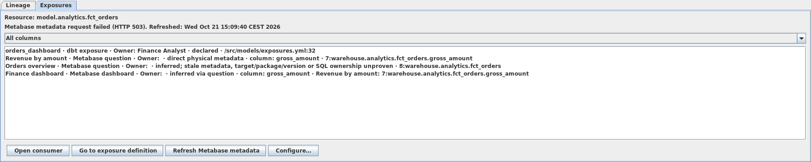

# dbt workspace

[User guide](getting_started.md)

Open **View → Tool Windows → dbt** for the **Lineage** and **Exposures** tabs.
dbt commands run in the
IDE's **Run** window, CTE inspection uses the **Debug** window, and clicking a Lineage
card opens its details on the right of the graph. Browsing the graph does not run dbt or
query the warehouse.

## Lineage

Cards represent models, source tables, seeds, snapshots and exposures; arrows lead
from upstream resources to their consumers. The graph follows the model in the
active editor unless its focus is pinned. The **Focus** label marks the graph focus;
a checkmark and border mark the selected card. Depth and layout direction are
[Lineage settings](configuration.md#lineage-settings). If the tab is blank, check the
[JCEF requirement](installation.md#requirements).

| Control | Action |
| --- | --- |
| Click a card | Select it, show its documentation on the right and dim unrelated resources. |
| Double-click a card | Focus the graph on it and open its definition. |
| Enter / Shift+Enter | On a keyboard-focused card: select it / focus the graph on it and open its definition. |
| **Inspect** | Choose a resource to center it at a readable size and open its details. |
| **Search resources** | Find a resource by resource or package name. **Clear search** returns to the selection. |
| **+ N more** | Reveal five more dependency levels in that direction. |
| **Pin focus** / **Unpin focus** | Stop or resume following the editor. Double-clicking a card still changes focus. |
| Drag | Move a card, or pan by dragging empty space. |
| Mouse wheel, **Zoom in**, **Zoom out** | Zoom. Automatic views keep cards at 80–100% zoom, so large graphs extend beyond the canvas. |
| **Fit graph** | Show the full overview. |
| Zoom percentage | Return to 100% around the selected or focused resource. |
| **Open Documentation** | Show details on the right for the selected resource, or the focused one when nothing is selected. |
| **Regenerate Docs** | Open a Generate Docs [Run configuration](#run-configurations) for the graph's execution project without launching it. |

### Resource documentation

Click a card, for example **orders**, to read its descriptions, columns, dependencies
and tests in the **Documentation** pane. Hovering over a card opens nothing.
Click a test name to open its source declaration. Tests without an available source
location appear as plain text.
The pane stays on the right as you move the mouse or pan the graph. Drag its left
divider to change its width; with the divider focused, use Left and Right arrow keys.
**Close documentation** returns that space to the graph.

Click a column name to inspect its upstream dependencies and downstream consumers
in the same pane. **Resource details** returns to the resource. **Airflow context**
appears only when the resource has detected Airflow tasks.
Descriptions render Markdown headings, lists, code and HTTP/HTTPS links. Links
open in your browser. Open details update when the project changes; a closed pane
stays closed.



### Filter, group and export

Enter **Selection** and **Exclude** expressions ([syntax](#review-a-selection-and-compare-a-baseline)),
then click **Apply**. Direct neighbors that do not match remain as dashed
**Filtered boundary** cards; other omitted resources are counted as hidden.
**Clear** restores the graph. **Run configuration…** opens a new dbt Run
configuration with the same Selection and Exclude values for you to review and save;
filtering never modifies existing Run configurations.

**Group by** offers **Schema**, **Folder** or **Tag (first alphabetically)**; a
resource with several tags appears under its alphabetically first tag. The **Groups**
panel beside the graph lists the groups: click one to collapse or expand it and move
the view to it.

Click or drag in the **Minimap** to navigate; arrow keys pan when it has focus.
Clear the **Minimap** checkbox to hide it. Open **Export** for **PNG**, **SVG**,
**Copy image** and **Include legend**. Exports capture the graph as filtered and
collapsed. If a graph is too large for PNG, collapse groups, narrow the filter or use SVG.

### Build and freshness badges

Cards with compatible execution results show build status, failing-test counts and
source freshness. Badge details identify the target and invocation. Click a badge
to open the recorded results in **Run**; this starts no command. Editing source
makes earlier results stale, and a missing badge does not mean success. Run the
**Source Freshness** command to update freshness.

## Exposures

Select **Exposures** beside **Lineage** to find declared dbt exposures and cached
Metabase questions and dashboards associated with the resource in the active
editor. **Tools → dbt Downstream Consumers** opens this tab for the resource at the
caret. The **Resource** label shows its scope; **All resources** means that no dbt
resource was recognized. Switching editors updates the scope even when Lineage
focus is pinned. Browsing the tab does not run dbt or query the warehouse.

Each row shows the name, type and owner when available, with the association
reason and supporting location or relation on a second line. Hover over a row
to read its evidence when the window is narrow. Declared exposures can depend on
the resource through downstream dbt models. Metabase questions match physical database,
schema and table metadata or SQL text; dashboards are inferred through their
questions. Inferred associations are candidates to inspect, not proof of usage.

| Control | Action |
| --- | --- |
| **All columns** / column name | Narrow Metabase rows to a known column. Exposures and rows without column evidence remain labeled **model-level; column use unknown**. The filter is retained when the same resource refreshes and reset when the resource changes. |
| **Open consumer** (browser icon) | Open the selected consumer's browser URL. Enabled only when the selected row has a URL. |
| **Go to exposure definition** (source icon) | Open the selected declared exposure. Enabled only for a row with a local declaration. |
| **Refresh Metabase metadata** (refresh icon) | Fetch read-only metadata explicitly. Disabled during a refresh; progress appears above the list. There is no automatic polling. Local exposures remain available without a connection. |
| **Configure…** (settings icon) | Open the integration settings; see [Metabase connection](configuration.md#metabase-connection). |

Actions appear in the toolbar above the list; hover over an icon for its name.
The **Column** filter is disabled when the current resource has no known columns.
The selected consumer is retained across refreshes and filter changes while it
remains in the list.

For example, `fct_orders` has columns `id` and `gross_amount`. The tab shows its
`orders_dashboard` exposure, the **Revenue by amount** question using
`gross_amount`, the **Finance dashboard** containing that question, and an
**Orders overview** SQL question matched only at model level:



Choosing **id** hides the question and dashboard whose known match is
`gross_amount`. The exposure and **Orders overview** remain with column use
unknown; their presence does not prove they use `id`:



The status shows the last successful refresh time and labels cached data older
than 15 minutes **stale** when the view updates. A failed refresh keeps the
previous consumers and timestamp, and shows the error:



These captures use the production panels in IntelliJ's tabbed content UI with a
local dbt project and local HTTP fixture metadata, without an installed IDE frame.
The cache lasts while the IDE project is open and is cleared when integration
settings are applied. Refresh fails above 20 databases or 1,000 questions; only the
first 100 dashboards are inspected and a larger list is marked partial. Dashboards
whose details cannot be fetched are omitted. Missing permissions, physical
metadata or supported query structures can leave consumers undiscovered, so an
empty list does not establish that a change is safe.

## Run dbt commands

### Compile a project

Choose **Tools → Compile dbt Project**, or right-click in an editor and choose
**dbt → Compile dbt Project**. Compilation starts immediately for the current
file's dbt project. With one dbt project, no open file is needed; with several
projects and no file belonging to one, choose a project from the popup.

The action uses the project's [execution settings](configuration.md#execution-settings)
and always compiles the whole execution project. For example, invoke it from
`models/orders.sql` to compile that model and the rest of its project. Output
appears in **Run**, where you can stop or rerun the command. See
[Compiled SQL](#compiled-sql) to open the generated SQL. You can also find
**Compile dbt Project** through **Find Action** or assign it a shortcut in
**Settings → Keymap**.

### Run configurations

Create a **dbt** configuration in **Run → Edit Configurations…**, or start one from:

- the Run gutter icon on the first line of a model, or the context Run action on a
  model, model directory or test file;
- the Run gutter icon beside a test ([Tests](#tests));
- **Run configuration…** or **Regenerate Docs** in [Lineage](#filter-group-and-export).

| Field | Effect |
| --- | --- |
| **Owning dbt root** | The source project's `dbt_project.yml` directory. |
| **Scope** | Absolute path to a model or model directory. Blank selects the whole execution project. |
| **Command** | One of the [commands](#commands) below. |
| **Target** | Overrides the active target. Blank uses the project setting or profile default. |
| **Selection** | dbt selection expression; overrides Scope. **Ctrl+Space** offers completions. |
| **Exclude** | Selection terms to remove; also supports **Ctrl+Space**. |
| **Named selector (overrides Selection)** | A definition in `selectors.yml`. |
| **Full Refresh (Run / Build)** | Rebuild selected incremental resources from all source data. |
| **Inline SQL** (Preview only) | A SELECT query previewed in the selected model's context. Blank previews the complete model. |
| **Executable override** | Executable or wrapper for this configuration. Blank uses the project's executable and prefix arguments. |
| **Prefix arguments** | Fixed arguments for the overridden executable, before the dbt command. |
| **Profiles directory override** | Directory containing `profiles.yml`. Blank uses the project setting. |

A configuration keeps its scope when you switch editors. **Effective scope** shows
which selection takes precedence; overridden fields are disabled. Command-specific
fields appear only for the applicable commands. Select **Show execution overrides** to
change the executable, prefix arguments or profiles directory. Overrides do not change
project settings; other values come from the [execution settings](configuration.md#execution-settings)
current at launch. Installed-package models run through their consuming project.

### Commands

| Command | Result |
| --- | --- |
| **Run** | Materialize models in the scope. |
| **Build** | Build selected resources and run their tests in the test console. |
| **Test** | Run selected data and unit tests in the test console. |
| **Compile** | Produce compiled SQL for the scope. |
| **Preview** | Query one model with `dbt show`; see [Preview query results](#preview-query-results). |
| **Generate Docs** | Run `dbt docs generate` for the whole execution project. |
| **Source Freshness** | Check sources for the whole execution project; leave Scope blank. |
| **Resolve Selection** | Run `dbt ls` and show the matched resources in **Find**. |

Commands save open documents first. One dbt command runs at a time per IDE project,
including previews, tests and CTE queries. Each invocation has its own **Run**
console with output, exit status and **Stop**. The console shows dbt log messages
with timestamps and warning or error labels and renders ANSI colors; other output
appears as received. Successful Run, Build, Compile and Generate Docs commands
reload artifacts. Completion notifications follow the
[notification setting](configuration.md#execution-settings).

### Review a selection and compare a baseline

| Selection | Meaning |
| --- | --- |
| `orders+` | orders and downstream consumers |
| `+orders` | orders and upstream dependencies |
| `tag:finance,resource_type:model` | Models with the finance tag |
| `orders customers` | Both selections combined |
| `selector:nightly` | The named definition in `selectors.yml` |

In the configuration editor, **Review selection** opens the locally matched resources
in **Find** without running dbt; entries open their declarations and incomplete
resolution is reported. **Copy command** copies the prepared command.
**Resolve with dbt ls** runs dbt in **Run** and opens its matches in **Find**. The
result is reused while the configuration, source and execution settings are
unchanged and all matched resources are known locally. A failed or canceled
resolution supplies no matches.

With a [baseline](configuration.md#baseline-state-and-deferral), `state:modified+`
selects changed resources and their consumers. **Compare baseline** opens a resource
chooser and a native diff of the recorded baseline values against the current SQL,
properties and configuration; current runtime defaults stay unresolved. It does not
check warehouse relations.
A missing or incompatible baseline blocks state-dependent commands.

### Tests

Click the Run gutter icon beside a singular SQL test, a YAML unit-test name or an
attached YAML data test. These configurations select the exact tests. Test and Build
results appear in the native test tree with output, durations, source navigation,
**Stop**, **Rerun** and **Rerun Failed Tests**. Rerunning failed tests selects only
failed or errored tests and keeps the original executable, prefix arguments,
profiles, target and environment. Model build results never count as passed tests.

The gutter icon then shows the latest result: green for passed, red for failed or
errored, yellow for warnings or skipped. Failure wins when several tests share a
line. The plain Run icon returns when no current result exists, including after
source or execution settings change.

Some attached generic tests need manifest identities to run exactly; run
**Generate Docs** for the matching project and target first. A missing or removed
identity stops the run with an explanation; the selection is never widened.

## Preview query results

**Preview** needs a dbt version that supports `show`. In a SQL model, click the Run gutter
and choose **Preview dbt model**, or choose **dbt → Preview dbt model** in its editor
context menu, to preview the complete model immediately. In a Run configuration,
select one model in **Scope**. In a local model
editor, right-click and open **dbt**:

- **Preview selected dbt SQL** runs the selected SELECT query.
- **Preview dbt CTE** runs the CTE at the caret with its dependencies.

These two need dbt Core 1.5+ and cannot preserve installed-package context; preview
the complete installed-package model instead.

If **Preview dbt CTE** cannot analyze the model, its dialog explains the reason
and confirms that no preview query ran. Parsing failures include the line and
column where available; the SQL may be incomplete or use syntax the plugin does
not support. Choose **Preview model** in the dialog to preview the complete model,
or **Cancel** to leave without running a query.

The **Rows** view shows the target, row count, limit and elapsed time. **May be
truncated** means the row limit was reached. Sort by column headers, resize or
reorder columns, and use **Filter** to search the returned rows. **Copy selection**
copies selected cells as tab-separated text. Choose CSV or TSV and click **Export
CSV** / **Export TSV** to save the filtered rows; SQL null exports as unquoted
`NULL` and the string NULL as `"NULL"`.
Replacing an existing export requires confirmation; **Cancel** keeps the file.

Changing **Preview row limit** alone runs nothing; **Run with limit** runs the query
again with that limit. **Open SQL** or **Open preview SQL** opens the executed SQL in
a read-only editor; process output stays in the console. After a CTE failure, **Go to CTE error** opens the matching
position in your source.

## Compiled SQL

In a model editor, right-click and open **dbt**. **Open Compiled dbt SQL** opens the
compiled SQL read-only, and
**Compare Authored and Compiled dbt SQL** opens a diff of **Authored SQL** and
**Compiled SQL**. If matching compiled SQL is unavailable, choose **Compile and
open** or **Compile and compare**. The plugin compiles the selected model with its
project execution settings and opens the result after successful compilation.
**Cancel** runs nothing; compilation failures remain in **Run**.

## Inspect CTE queries

In a local SQL model, click the Run gutter icon and choose **Debug dbt CTEs**, or
choose **dbt → Inspect dbt CTEs** from the context menu. Debug compiles that model
using its owning project's [execution settings](configuration.md#execution-settings)
and active target. Run configuration overrides do not apply. Compilation can run
queries used by macros to discover warehouse metadata; it does not materialize
the model. Inspection queries start only when you use **Step Over** or **Resume**.

Source-mapped inspection requires the Python dbt Core 1.8+ CLI. Its process must
preserve `PYTHONPATH`, including when launched through a wrapper. Native/Fusion
CLIs cannot supply these mappings. Compilation failures, unsupported runtimes and
SQL parsing failures appear in the Debug console. A compiled model without
supported top-level CTEs has no inspection steps.

### Source breakpoints and compiled SQL

Set breakpoints in the gutter of a SQL model or macro definition, then start Debug
from the model you want to inspect. Breakpoints stay pending until compilation.
A resolved breakpoint binds to the generated CTEs that contain SQL produced by
that source line. **Resume** pauses after a matching CTE's result is available,
highlighting the source line. Disabled and muted breakpoints do not stop Resume.

For example, this model delegates its query to a macro:

```sql
{{ config(materialized='view') }}

{{ wms_stage_packaging_input(
    source('wms_raw', 'all_cma_pairwise_final_output_all_demo_combinations')
) }}
```

A breakpoint on `wms_stage_packaging_input(` binds to the CTEs produced by that
call. A breakpoint on a SQL-producing line inside the macro can select a narrower
set of CTEs. Nested macro calls and repeated loop expansions retain separate
generated steps. A breakpoint shared by several steps can stop on the same
source line more than once.


**Step Into** opens the current CTE in read-only compiled SQL without running a
query. **Step Over** advances one generated CTE at a time in either view.
**Step Out** returns to the current CTE's mapped source location.


These captures show the native IntelliJ editor and Debug Rows panels without the
surrounding IDE frame, using a local dbt Core/DuckDB project. The macro generates
two CTEs that return a single `id` value.

Lines that produce no inspectable CTE remain unresolved; hover over the breakpoint
for the reason. String transformations can remove an inner macro location while
leaving its enclosing output expression mapped. SQL without a reliable source
location opens at its compiled location, and its frame says **source mapping
unavailable**. The debugger never chooses a source line by guessing from similar
SQL text.

### Controls and results

**Frames** lists the compiled model's top-level CTEs in SQL order. CTEs nested
inside another CTE are not separate steps. Select a frame to see its cached result
in **Rows**.

| Control | Action |
| --- | --- |
| **Step Over** | Query the next CTE with the CTEs it depends on. The first step queries the first CTE. After source changes, the first step recompiles only; step again to query. |
| **Resume** | Query successive CTEs until a mapped source breakpoint, failure or the end. |
| **Step Into** | Show the selected CTE in compiled SQL without querying. |
| **Step Out** | Show its mapped source location without querying. If no source mapping exists, keep the compiled location. |
| **Cached Step Back** | Show the previous cached result without querying. |
| **Count all CTE rows** | Count all rows of the selected CTE in a separate query. |
| **Restart CTE inspection** | Clear progress and cached results. The next step queries the first CTE, or recompiles first if source or settings changed. |
| **Stop** | Cancel this inspection's compilation or query and end the session. |

**Run to Cursor** is unavailable. Inspection breakpoints do not pause a normal
**Run** command, an executing warehouse query, or Jinja evaluation. Each step runs
a separate bounded query and recalculates its dependencies, so random values and
timestamps can differ between steps. Only one dbt process runs per IDE project.

Editing the model, a contributing macro or another resource of its execution
project, or changing execution settings, cancels the current command and discards
cached results and source mappings. An explicit step recompiles before any more
inspection queries can run. Failed or canceled compilations provide no steps.

Recursive CTEs, explicit CTE column lists, unsupported SQL dialects and queries that
modify data or schema are rejected before an inspection query runs. Compilation
can still have executed macro queries. Error details retain the submitted and
adapter SQL when available; **Go to CTE error** navigates to the corresponding
compiled SQL location. To browse source CTEs without compiling or querying, use the
[CTE structure view](navigation.md#cte-structure-and-hierarchy).
