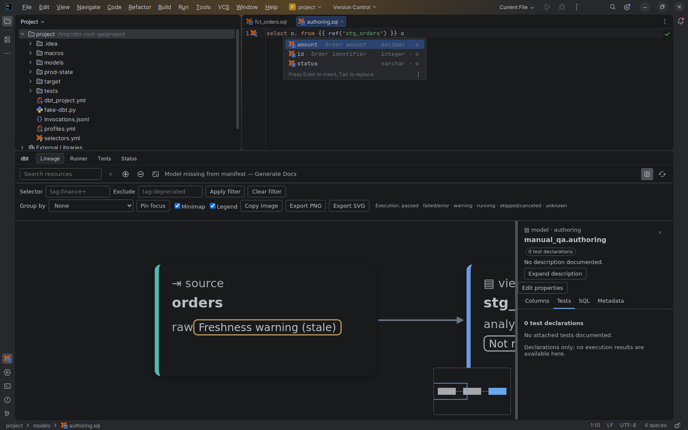

# dbt and SQL completion

[Capability index](README.md) · [User guide](../docs/editor.md#completion-and-parameter-information)

When you press **Ctrl+Space** (or choose **Code → Code Completion → Basic**), the plugin suggests dbt names and SQL columns that are valid at the caret position.

## Where completion works

Completion works in files of a dbt project that are not ignored:

- model, macro, test and other resource files;
- `selectors.yml`;
- standard `selectors.yml` files.

In any other file, the plugin adds no suggestions.

## What is suggested

What the plugin suggests depends on where the caret is.

| Caret position | Suggestions |
| --- | --- |
| Inside the quotes of `ref('…')` | Models, seeds and snapshots |
| First argument of `ref('…', 'model')` | Package names |
| Second argument of `ref('package', '…')` | Models, seeds and snapshots of that package |
| Inside the quotes of the `v=` or `version=` argument of `ref` | Versions of the referenced model |
| First argument of `source('…')` | Source names |
| Second argument of `source('raw', '…')` | Tables of the source `raw` only |
| Inside the quotes of `doc('…')` | Doc blocks; with two arguments, doc blocks of the package named in the first argument |
| Inside the quotes of `var('…')` | Project variables |
| First argument of `adapter.dispatch('…', 'package')` | Macro names from `package`, without the adapter prefix (`default__money` is offered as `money`) |
| Inside `config(…)`, outside quotes | Configuration keys followed by `=`, for example `materialized=` |
| Inside a macro call, outside quotes | The macro's arguments followed by `=`, with their defaults and documented types |
| Inside `{{ }}` or ``, outside any call | Macros and the dbt functions `ref`, `source`, `doc`, `var` and `config` |
| After `package.` inside `{{ }}` or `` | Macros of that package |
| In `selectors.yml` or a selection file | `package:<name>`, `tag:<tag>`, `selector:<name>`, and names of models, seeds and snapshots |
| In SQL, outside `{{ }}` and `` | Columns of all tables visible at the caret |
| In SQL, after `alias.` | Columns of the table with that alias only |

Each suggestion shows extra details next to its name:

- dbt resources show their kind, package and model version, for example `model · my_project v2`, and their description.
- Columns show their data type and the table alias, for example `numeric · o`, and their description.

## Limitations

- Column suggestions include only columns the plugin knows about: columns declared in YAML, output columns of models, and columns of subqueries and CTEs. If a table's columns are not known, its columns are missing from the list or incomplete.
- If the `version` argument of `ref` is not a plain value, no versions are suggested.
- Completion reads project files only. It does not run dbt or connect to the database.

## Live templates

The live templates `dbtref`, `dbtsource` and `dbtconfig` insert these calls with placeholders that you fill in:

| Template | Inserted text |
| --- | --- |
| `dbtref` | `{{ ref('model_name') }}` |
| `dbtsource` | `{{ source('source_name', 'table_name') }}` |
| `dbtconfig` | `{{ config(materialized='view') }}` |

The templates do not check whether the names you type exist.

## Example

The model `stg_orders` has the columns `id`, `amount` and `status`:

```sql
select o. from {{ ref('stg_orders') }} o
```

With the caret after `o.`, completion offers `id`, `amount` and `status`. Choosing `amount` produces `o.amount`.

## Screenshot



Column completion after `o.` for the `stg_orders` model.

## Interactions

- [Parameter information](parameter-information.md) shows the full argument list of the macro you are calling.
- [YAML authoring](yaml-authoring.md) provides completion of keys and structure in YAML property files.
