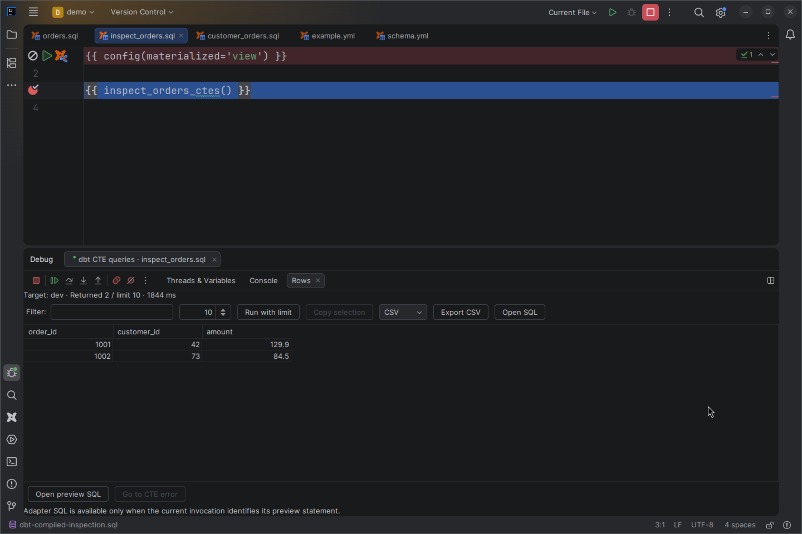
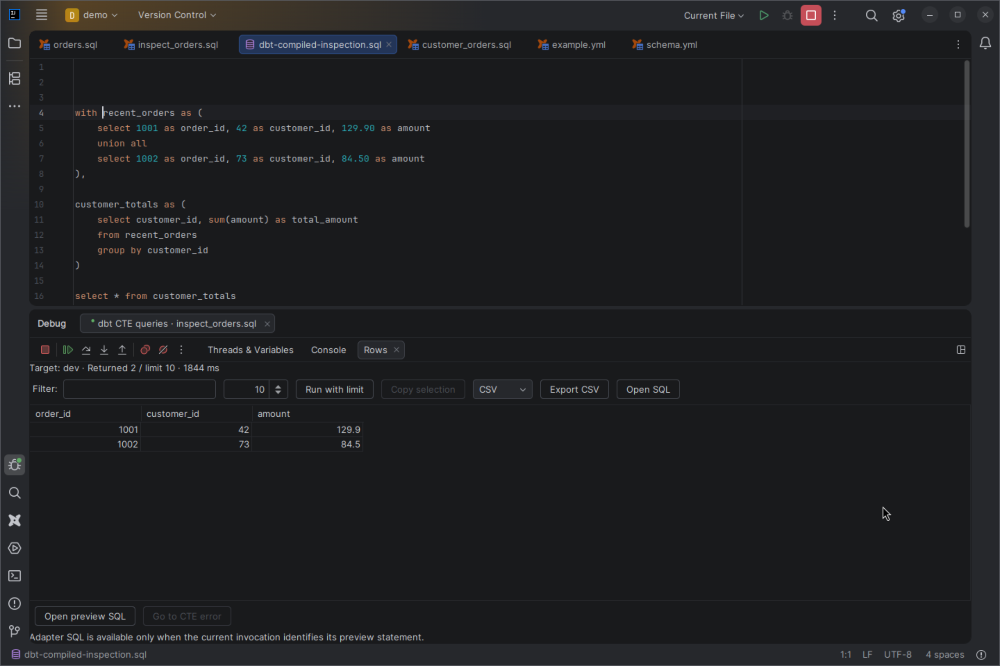

# Step through CTE results

[Capability index](README.md) · [User guide](../docs/workspace.md#inspect-cte-queries)

Inspect the top-level CTEs of a compiled local SQL model in IntelliJ's native
Debug window. Source breakpoints can refer to the model or a macro that generates
its SQL. Each inspection step runs an independent, bounded query.

## Contract

- **Inputs:** one local SQL model, its owning execution project and target, and
  optional source breakpoints. Runtime requirements and controls are authoritative
  in [Workspace](../docs/workspace.md#inspect-cte-queries).
- **Outputs:** compiled CTE frames, source or compiled execution locations,
  bounded rows, submitted/adapter SQL evidence and explicit unresolved mappings.
- **Compilation:** Debug invokes the configured dbt CLI through the shared runner.
  It uses the real dbt rendering context and can execute introspective macro
  queries. It does not materialize the model. CTE previews require explicit
  stepping after compilation.
- **Source mapping:** generated CTEs retain their known model and macro locations,
  including separate loop expansions and repeated macro calls. Similar SQL text
  never establishes a source mapping. If a transformation loses an inner location,
  only its known enclosing source expression remains available.
- **Breakpoints:** resolve against the selected model's compilation. A matching
  breakpoint stops after the CTE result arrives. One source breakpoint can match
  several generated CTEs; each remains a separate step. Unmapped lines stay
  unresolved and never cause a guessed source highlight.
- **Locations:** retain separate source and compiled positions. Compiled view
  switching runs no query. With no reliable source mapping, use the compiled
  position and label the frame accordingly.
- **Compilation state:** generated SQL, mappings, results and execution settings
  belong to one compilation. Resource, model, macro or execution-context changes
  cancel the active command and discard those results and mappings. Recompilation
  requires an explicit action; a further explicit step starts a preview.
- **Failures:** canceled, failed or stale compilation and invalid source mappings
  provide no inspection steps. Missing source-mapping support, unsupported
  SQL and models without top-level CTEs give a reason in Debug. Query failures stop
  Resume and preserve available evidence; error navigation targets compiled SQL.

This is inspection between separate CTE preview queries. It does not suspend an
executing warehouse query or step through Jinja evaluation at runtime.

## Example and visual evidence

```sql
{{ config(materialized='view') }}

{{ wms_stage_packaging_input(
    source('wms_raw', 'all_cma_pairwise_final_output_all_demo_combinations')
) }}
```

With a breakpoint on the macro call, Debug compiles its expansion. Resume queries
its first CTE, shows its rows and highlights the source call. Step Into opens the
corresponding read-only compiled SQL without querying again.





See [Workspace](../docs/workspace.md#source-breakpoints-and-compiled-sql) for
controls and mapping boundaries.

## Interactions

[Query preview](query-preview.md) owns the bounded grid and execution evidence.
[Workspace execution](workspace.md) owns the shared process lifecycle. Source-only
[Structure](../docs/navigation.md#cte-structure-and-hierarchy) remains independent
of compilation and queries.
