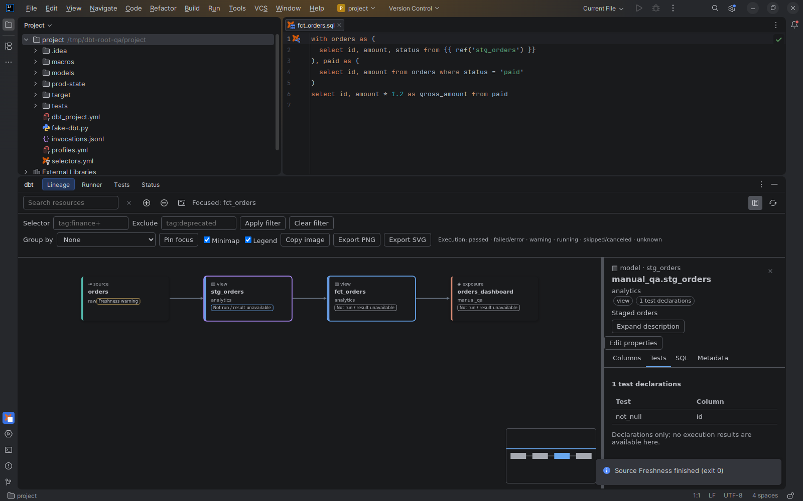

# Build, test and freshness evidence

[Capability index](README.md) · [User guide](../docs/workspace.md#build-and-freshness-badges)

Show recorded execution and freshness status alongside resource dependencies.

## Contract

- **Inputs:** supported command results, run artifacts and source-freshness artifacts tied to an execution context.
- **Outputs:** resource badges, failing-test counts, freshness state and details of the recorded target/run.
- Missing results remain unavailable; an absent badge is not a successful build. A passing test does not claim that its model was built.
- Source-only tests can contribute to their referenced model's failing-test count without a manifest test entry.
- Changed source makes earlier evidence stale. Partial or malformed result records cannot become complete success evidence.
- Opening a badge navigates to the corresponding recorded result rather than starting a run.

## Example

A failed orders test gives the related model a failing-test count. A separate source-freshness run can put a warning on `raw.orders`. These are separate observations; neither proves that the fact model built successfully.

## Screenshot

Source-freshness warning badge produced from simulated command artifacts.

## Interactions

Connects [test results](test-execution.md) and [workspace commands](workspace.md) to [resource lineage](resource-lineage.md).
