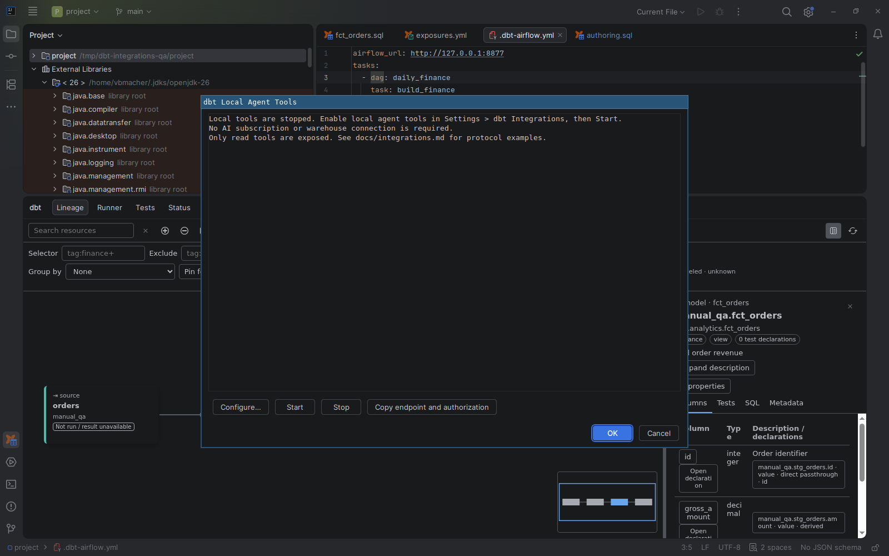

# Local read-only MCP server

[Capability index](README.md) · [User guide](../docs/integrations.md#connect-an-ai-assistant-with-the-local-mcp-server)

Give an AI assistant on the same computer read-only access to the dbt project model the IDE has already resolved, so it does not need to run dbt or connect to the warehouse.

## Contract

- **Inputs:** user opt-in, explicit service start and authenticated MCP requests over Streamable HTTP.
- **Outputs:** project/resource lists, reference/selection resolution, documentation, and resource/column lineage.
- The service binds to loopback with a fresh bearer token on each start. Stop, project close or disabling opt-in ends access.
- It has no command-execution or warehouse-write tool. Responses omit profile/environment secret values and warehouse rows.
- Resource lineage returns one dependency step per request. Partial results are marked when limits are reached.
- The service is an MCP server with tools only, at `/mcp` over Streamable HTTP. It supports MCP `2026-07-28` (stateless, `server/discover`) and `2025-11-25`, `2025-06-18`, `2025-03-26` (`initialize`). It answers with JSON bodies only: no SSE streams, sessions or stdio transport. Versions, headers, error codes and bounds are defined in the [MCP protocol reference](../docs/integrations.md#mcp-protocol-reference).

## Example

After explicitly starting the service, an authenticated MCP client using version `2026-07-28` asks for the tools. The request carries the headers `MCP-Protocol-Version: 2026-07-28` and `Mcp-Method: tools/list`:

```json
{"jsonrpc":"2.0","id":1,"method":"tools/list","params":{"_meta":{"io.modelcontextprotocol/protocolVersion":"2026-07-28","io.modelcontextprotocol/clientCapabilities":{}}}}
```

It can then call `get_documentation` for a project/resource identity returned by `list_projects` and `list_resources`. These requests do not run dbt.

## Screenshot



Local MCP server dialog in its stopped state, without an exposed token.

## Interactions

Provides read-only access to the same [project context](project-context.md), [navigation](navigation.md), [lineage](column-lineage.md), and [selection](selection-review.md) contracts.
