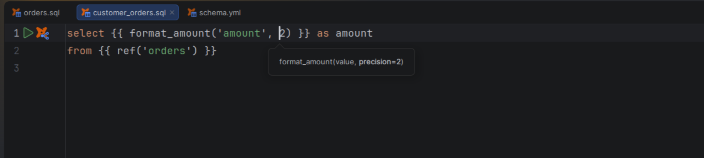

# Macro parameter information

[Capability index](README.md) · [User guide](../docs/editing.md#completion-and-parameter-information)

Show a macro’s argument names and defaults while writing a call.

## Contract

- **Inputs:** a macro call at the caret and its resolvable signature.
- **Output:** a parameter hint with names, defaults, available documented types and the active argument highlighted.
- Parameter information describes the declaration; it does not validate argument counts or value types.
- Missing or ambiguous definitions cannot supply one authoritative signature.

## Example

```jinja

  round({{ amount }}, {{ scale }})

{{ money(100, 2) }}
```

With the caret in the call, Parameter Info displays `money(amount, scale=2)` and highlights the current argument.

## Screenshot



Native parameter hint for money(amount, scale=2).

## Interactions

[Completion](completion.md) suggests named arguments. [Static analysis](static-analysis.md) checks supported unknown keyword arguments separately.
