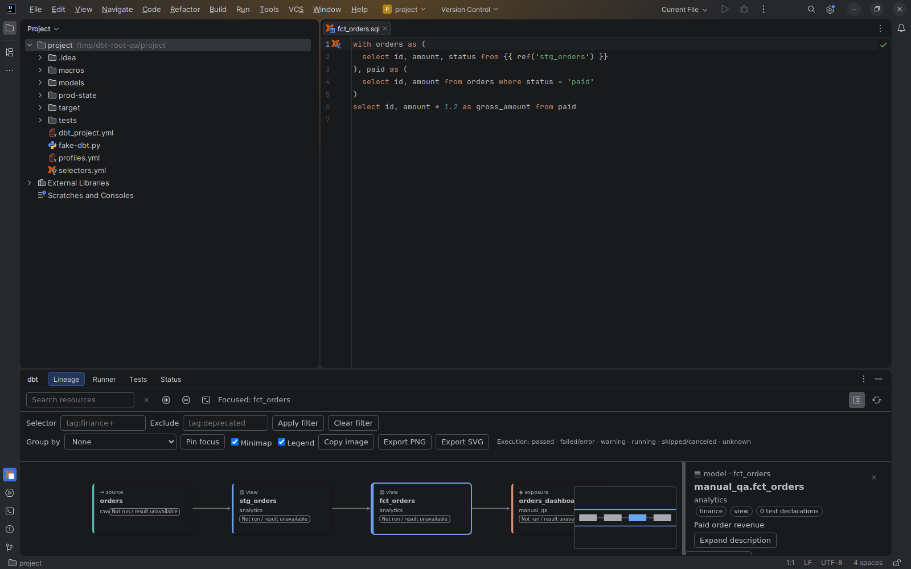

# Project context and local metadata

[Capability index](README.md) · [User guide](../docs/configuration.md)

Keep names and resources associated with their owning dbt project, including projects with installed packages.

## Contract

- **Inputs:** local dbt project files, unsaved editor content, installed package sources and explicitly selected local metadata.
- **Output:** resources identified by project, package, kind and model version, available to the other capabilities.
- Local source takes precedence over supplemental metadata. Metadata-only declarations remain read-only and carry provenance or stale labels.
- Independent projects do not share private declarations. Installed packages are resolved through their consuming project.
- Ignored and generated paths are excluded according to [project discovery rules](../docs/configuration.md#projects-and-ignored-files).
- Engine, version, adapter and metadata compatibility follow [Configuration](../docs/configuration.md); unsupported or ambiguous declarations must not become a guessed target.

## Example

An IDE project contains `analytics/dbt_project.yml` and an installed package named `finance`:

```jinja
{{ ref('finance', 'orders', v=2) }}
```

The reference identifies version 2 in `finance` within the consuming project's context. A different independent project named `finance` is not a substitute.

## Screenshot



Disposable dbt project with local models, macros, tests and project files.

## Interactions

Provides the resource identity used by [navigation](navigation.md), [completion](completion.md) and [workspace commands](workspace.md).
