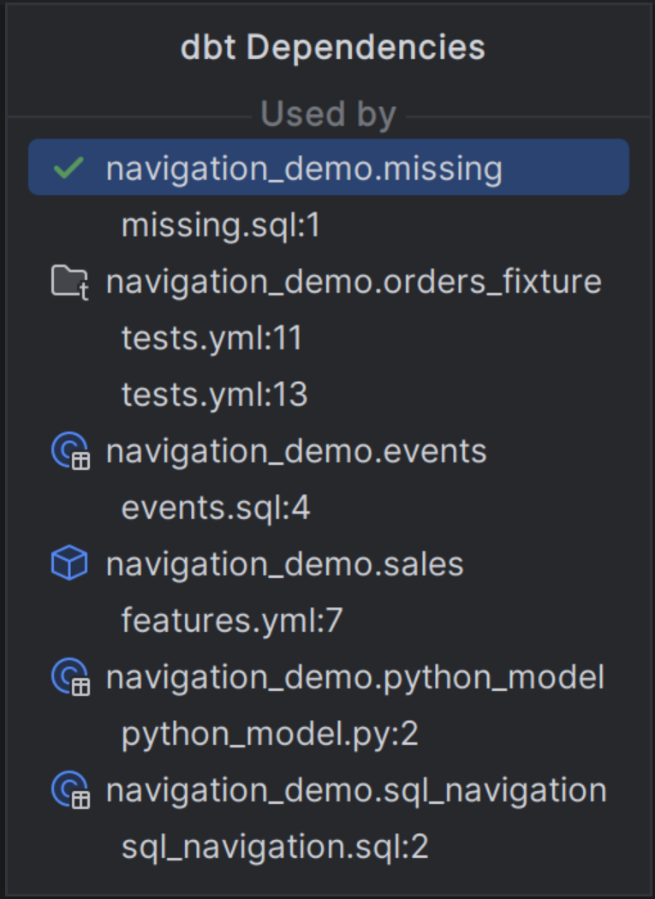
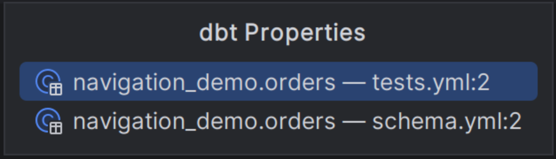

# Properties, dependencies and gutter navigation

[Capability index](README.md) · [User guide](../docs/navigation.md#gutter-markers)

Browse a resource’s declarations, upstream dependencies and downstream callers without running dbt.

## Contract

- **Inputs:** the current resource, declaration or reference and its resolved relationships.
- **Outputs:** related YAML/source targets and dependency entries with reference locations.
- Dependencies distinguish **Uses** from **Used by**. Resource entries open declarations; child `file:line` entries open the corresponding call site.
- Gutter targets on one line share a chooser. Ambiguous and metadata-only references retain their explanatory labels.
- A resource with no known related target does not acquire a fabricated dependency. Dynamic dependencies can remain unknown.

## Example

If `report.sql` contains `ref('orders')`, the orders resource has a **Used by** entry for report. Its indented call-site entry opens that reference; **dbt Properties** opens orders' YAML properties.

## Screenshot

Dependency chooser with consumers and their reference locations.

Property chooser for the orders model.

## Interactions

Uses [declaration navigation](navigation.md). The [resource graph](resource-lineage.md) presents the same kind of relationships visually.
