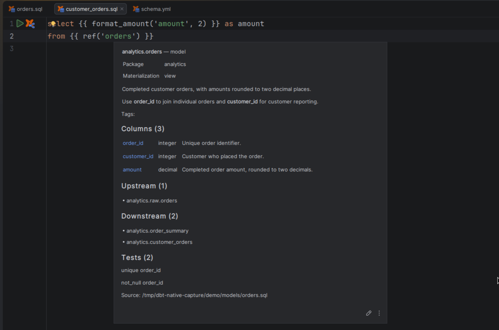

# Quick documentation

[Capability index](README.md) · [User guide](../docs/editing.md#quick-documentation)

Read resource or macro details and builtin dbt reference material at the editor location.

## Contract

- **Inputs:** a resolvable resource argument, macro name or builtin dbt name.
- **Outputs:** resource descriptions, known columns and dependencies, or the selected dbt version's reference article.
- Resource text follows [source and metadata precedence](project-context.md). Source logical names and physical relation names remain distinct.
- Resource popups and the Documentation window show complete known column/dependency lists with counts; [resource documentation](resource-documentation.md) owns their shared content.
- Builtin articles and related reference links open in the Documentation tool window. Configured local builtin definitions can replace documentation targets; see [Configuration](../docs/configuration.md#local-builtin-definitions).

## Example

```sql
select * from {{ ref('orders') }}
```

Quick Documentation on `orders` shows its description, known columns and dependencies. On `ref`, it shows the builtin reference article.

## Screenshot



## Interactions

[Navigation](navigation.md) determines the target. [Resource documentation](resource-documentation.md) owns the complete content in native Documentation.
