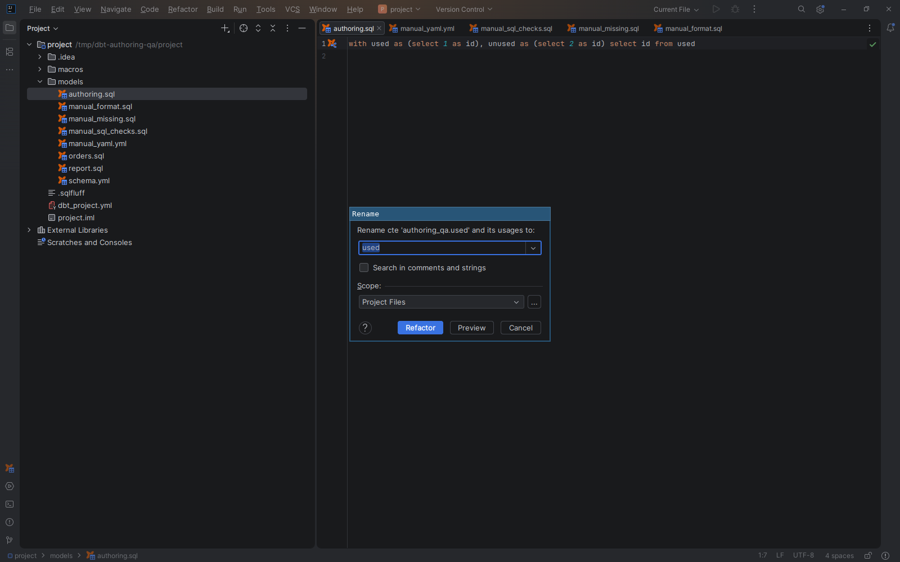

# Rename dbt resources and SQL symbols

[Capability index](README.md) · [User guide](../docs/editor.md#rename-and-safe-delete)

Rename a local declaration and update the references that resolve to it.

## Contract

- **Inputs:** a local model, macro, CTE, relation alias or supported SQL output column and a proposed name.
- **Output:** coordinated declaration/reference edits through the IDE refactoring flow, with conflict review and Undo.
- Model changes coordinate filenames and YAML while preserving physical aliases and version `defined_in` mappings.
- Renaming a simple output can introduce an alias so that the physical input name is preserved.
- Dynamic consumers, ambiguity, name collisions and read-only edits can block refactoring. Physical source/seed/snapshot columns, explicit CTE column lists and shared version declarations need direct source edits.

## Example

```sql
with recent as (select id from {{ ref('orders') }})
select id from recent
```

Renaming the CTE `recent` to `recent_orders` updates its declaration and resolving `from recent` reference together.

## Screenshot



Native Rename dialog for a local CTE.

## Interactions

Uses [reference resolution](navigation.md). [Safe Delete](safe-delete.md) checks the corresponding removal operation.
