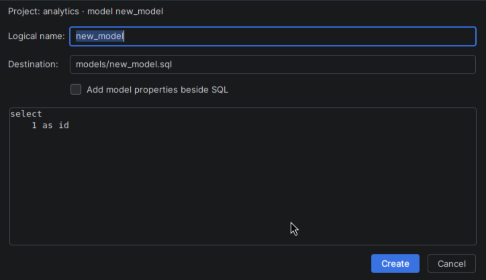

# Create missing resources

[Capability index](README.md) · [User guide](../docs/editing.md#create-a-missing-resource)

Create a local model or source-table declaration from a supported unresolved literal reference.

## Contract

- **Inputs:** a missing unversioned local `ref` or a literal `source` call in its owning project.
- **Output:** a reviewable path and proposed contents, then source files or a source-table YAML entry when applied.
- Creation uses the project's configured resource paths and can extend an existing local source declaration.
- Existing files are not overwritten. Ambiguous/read-only source declarations, installed packages and runtime-computed names cannot be created through this action.
- The proposal must still match the source when applied; a stale proposal cannot silently edit a changed reference.

## Example

```sql
select * from {{ ref('new_model') }}
```

For a missing `new_model`, **Create missing dbt resource** proposes a model under the owning model path with a starter query. Review the path and content before creating it.

## Screenshot



## Interactions

[Static analysis](static-analysis.md) identifies unresolved literal references. [Project context](project-context.md) determines the destination owner.
