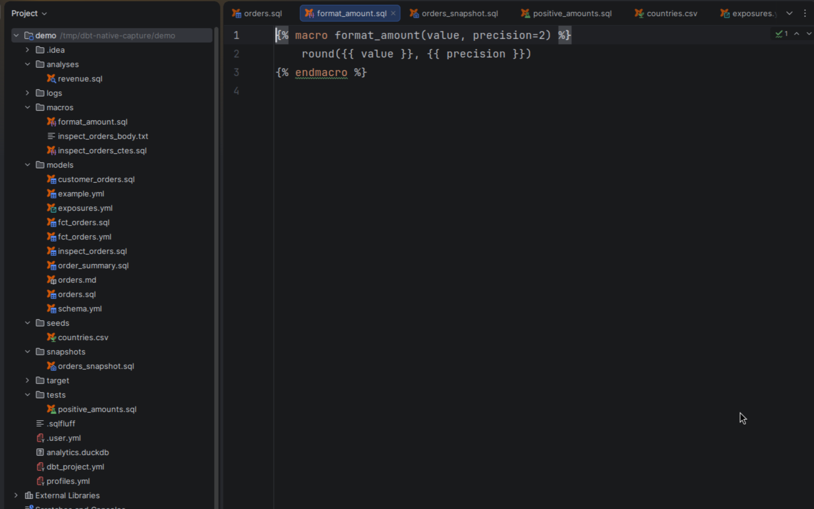

# Resource icons

[Capability index](README.md) · [User guide](../docs/icons.md)

Identify dbt resource kinds in the Project window and navigation/completion results.

## Contract

- **Inputs:** a recognized file or declaration, its resource path and effective kind.
- **Output:** a resource icon on the applicable IDE surface.
- Files use their resource icon first; YAML-only declarations can determine the file icon when their kinds agree. Mixed files retain their normal file-type icon.
- Navigation gutter markers indicate available related targets; test Run gutters
  show recorded execution outcomes separately. Dependency direction comes from
  **Uses** / **Used by**, not the navigation icon.
- Exact icon meanings, locations and exceptions are defined once in the [icon legend](../docs/icons.md).

## Example

`models/orders.sql` uses the model icon. A YAML file containing only attached tests can use the test icon, while navigation to the model declaration keeps its model icon; see the legend's attached-test rule.

## Screenshot

## Interactions

[Project context](project-context.md) identifies resources. [Gutter navigation](properties-and-dependencies.md) uses the corresponding navigation marker.
