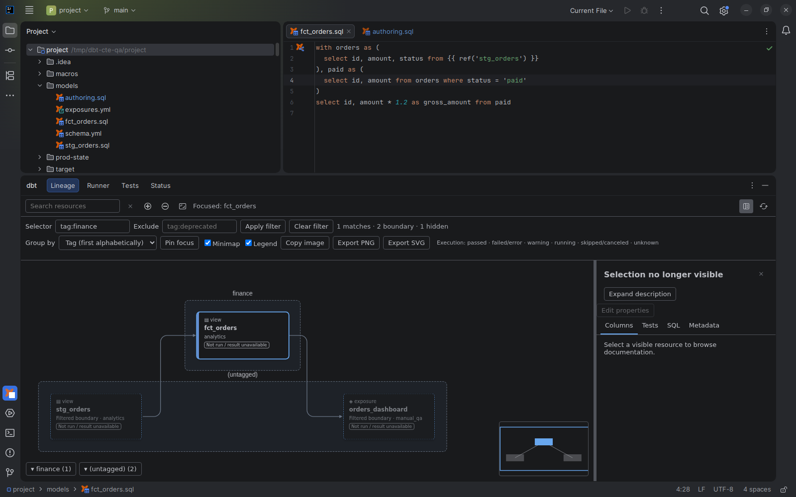

# Resource lineage graph

[Capability index](README.md) · [User guide](../docs/workspace.md#lineage)

Explore resource dependencies visually and share a focused graph.

## Contract

- **Inputs:** current resource dependencies, editor focus, optional selection/exclusion filter and presentation choices.
- **Outputs:** directed cards and edges for resources, grouped/collapsed views and graph image exports.
- Arrows point from upstream resources to consumers. Focus can follow the editor or remain pinned.
- Filtering preserves immediate nonmatching neighbors as boundary cards and reports other hidden resources. Grouping and collapsing change presentation, not dependencies.
- Search, zoom, panning, minimap navigation and image export do not execute dbt. Export reflects the current filter/collapse state.
- Clicking a resource opens shared resource documentation in a fixed, horizontally
  resizable pane on the right. Hovering opens nothing. Column details stay in that
  pane; see [Workspace](../docs/workspace.md#resource-documentation).
- Resource identities stay distinct across packages, versions and owning projects. Missing or partial metadata must not invent edges.
- Clipped card names retain their beginning and end; accessible names retain the full resource name and location. Search reports matches, including an explicit no-match result. Opening or resizing documentation keeps the selected resource visible, preserving zoom when the card fits and otherwise using the readable automatic framing limits.
- The graph's controls and export limits are owned by [Workspace](../docs/workspace.md#filter-group-and-export).

## Example

For `raw.orders → stg_orders → fct_orders → orders_dashboard`, filter to the finance-tagged fact model. Immediate nonmatching dependencies remain visible as dashed boundary cards; a schema group can collapse without changing the underlying relationships.

## Screenshot

Finance selection with dashed filtered-boundary resource cards.

## Interactions

[Selection review](selection-review.md) accepts filter values only through the explicit Use in Run Configuration action. Graph focus, selected resource, graph filters and execution scope remain separate. [Resource documentation](resource-documentation.md), [column lineage](column-lineage.md) and [execution evidence](execution-evidence.md) add detail to selected resources.
