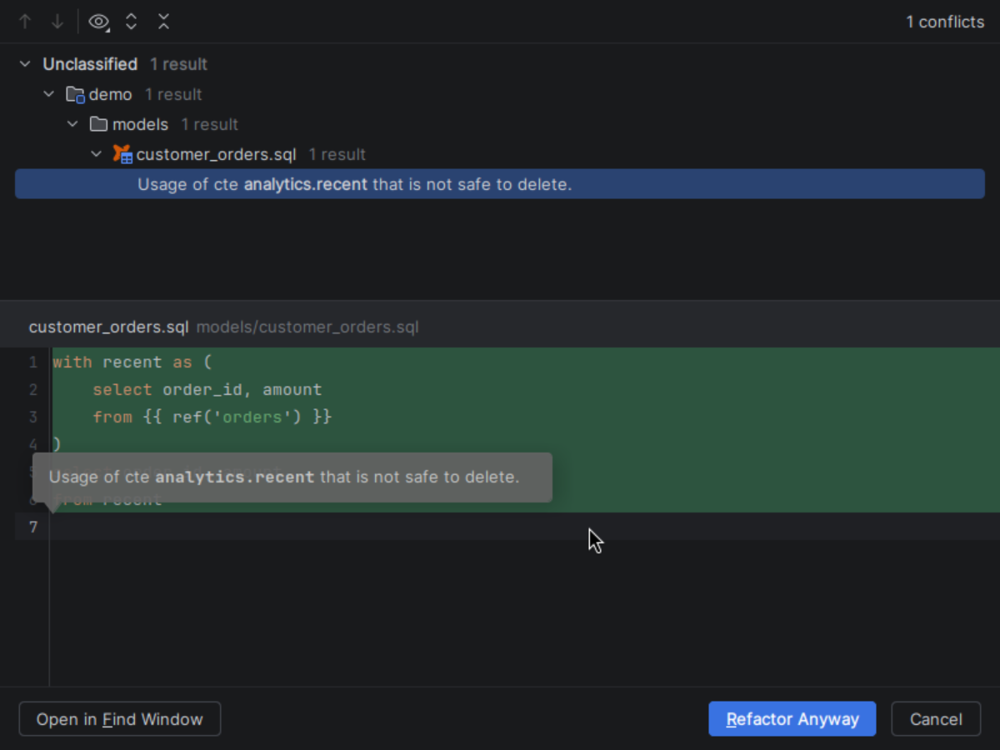

# Safe Delete

[Capability index](README.md) · [User guide](../docs/editing.md#rename-and-safe-delete)

Remove supported local declarations only after reviewing their usages and conflicts.

## Contract

- **Inputs:** a model, macro, CTE or supported projection selected for deletion.
- **Output:** a usage/conflict review followed by coordinated deletion when safe, with Undo.
- Model deletion includes its corresponding properties; macro deletion removes its block.
- Referenced declarations, dynamic or ambiguous consumers, unsupported/read-only edits and deleting the only projection can block removal.
- A resource is not considered unused merely because a dynamic reference cannot be resolved.

## Example

```sql
with unused as (select 1 as id), kept as (select 2 as id)
select id from kept
```

Safe Delete can remove the unused CTE. Deleting `kept` instead reports its consumer rather than leaving a broken query.

## Screenshot



## Interactions

Shares supported local declarations with [Rename](rename.md) and uses [Find Usages](navigation.md) for the review.
