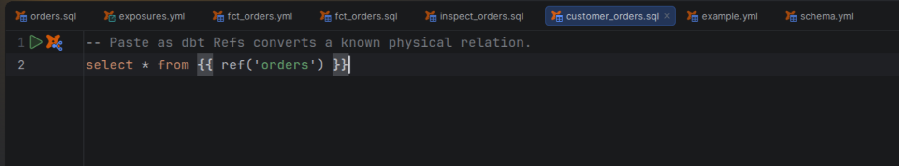

# SQL clipboard conversion

[Capability index](README.md) · [User guide](../docs/editing.md#sql-clipboard-conversion)

Convert static dbt relations for a target database and convert uniquely known physical names back to dbt references.

## Contract

- **Inputs:** selected SQL or the whole document for copying; clipboard SQL and an insertion range for pasting; matching physical relation metadata.
- **Outputs:** clipboard text with physical names, or inserted SQL containing resolving refs/sources.
- Copy leaves the document unchanged. Paste changes the selected range/caret location and supports Undo.
- Static `ref`, `source` and `this` conversions preserve physical aliases and quoting. Other Jinja is wrapped in marked comments and can be restored on paste.
- Two-/three-part physical names convert back only for unique metadata matches, retaining package and version identity. Unmatched text remains intact.
- Missing or mismatched project/target provenance produces a warning; configuration belongs to [Configuration](../docs/configuration.md#local-metadata).

## Example

With metadata mapping orders to `"analytics"."reporting"."orders"`:

```sql
select * from {{ ref('orders') }}
```

Copy for Target DB places `select * from "analytics"."reporting"."orders"` on the clipboard. Paste as dbt Refs can restore the ref when that relation matches uniquely.

## Screenshot



## Interactions

Uses [local metadata](project-context.md) for physical names and [navigation](navigation.md) for logical identity.
