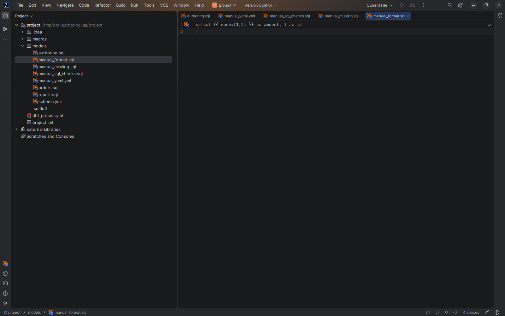

# SQL formatting

[Capability index](README.md) · [User guide](../docs/editor.md#sql-linting-and-formatting)

Format a dbt SQL/Jinja document with the project’s chosen formatter.

## Contract

- **Inputs:** a supported dbt SQL document and the configured sqlfmt or SQLFluff executable.
- **Output:** formatted document text from a background process, applied with Undo.
- Reformat Code and optional format-on-save use the same owning execution context.
- SQLFluff formatting uses its `format` command; lint inspection is a [separate capability](sql-inspection.md).
- Failure, cancellation, timeout or document changes while formatting preserve the current document. Executable and environment requirements belong to [Configuration](../docs/configuration.md#sql-linting-and-formatting).

## Example

```sql
select  id,amount from {{ ref('orders') }} where id>0
```

Reformat Code passes this document to the configured formatter and applies that formatter's result. Exact layout follows its project configuration.

## Screenshot



SQL/Jinja document formatted by sqlfmt in the native editor.

## Interactions

Uses the owning context from [workspace execution](workspace.md). Formatting does not run the dbt model.
