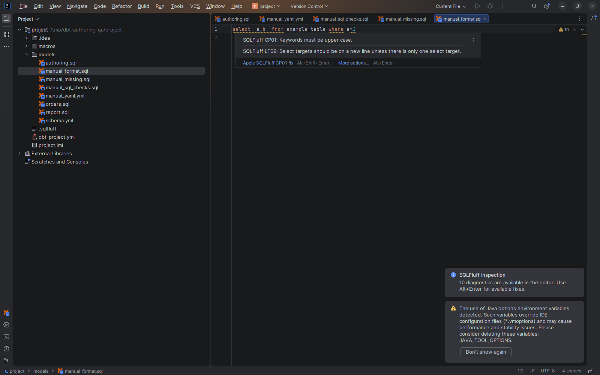

# SQLFluff inspection and fixes

[Capability index](README.md) · [User guide](../docs/editor.md#sql-linting-and-formatting)

Run the configured SQLFluff lint rules and apply an offered source fix.

## Contract

- **Inputs:** current dbt SQL, SQLFluff configuration and its configured executable/environment.
- **Outputs:** editor warnings/errors and supported fix proposals from an explicit inspection.
- A document edit invalidates the inspection result; the user must inspect again.
- Parse or templating errors prevent fix offers. Applying a fix must still match the inspected source and supports Undo.
- Process failures are reported rather than presented as clean SQL. sqlfmt cannot supply SQLFluff diagnostics.

## Example

With a project rule requiring uppercase keywords, inspect:

```sql
select id from {{ ref('orders') }}
```

SQLFluff reports the configured capitalization diagnostic. Apply its offered fix to change the relevant keyword.

## Screenshot



SQLFluff capitalization diagnostic and source fix in the editor.

## Interactions

[SQL formatting](sql-formatting.md) handles whole-document layout. [Static analysis](static-analysis.md) supplies local semantic warnings without an external linter.
