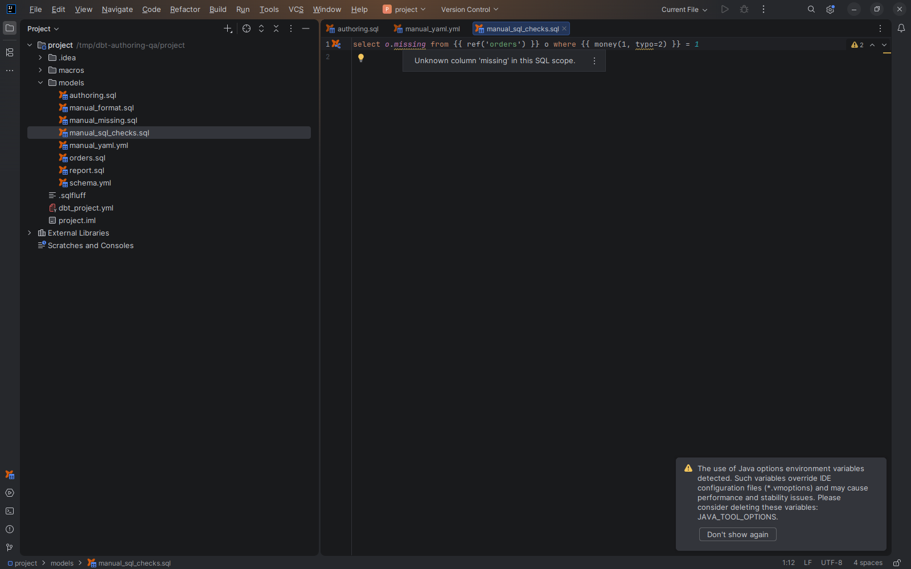

# Reference, SQL and contract warnings

[Capability index](README.md) · [User guide](../docs/editing.md#editor-warnings)

Identify reference and SQL problems that can be established from the project’s current source.

## Contract

- **Inputs:** literal dbt calls, resolvable SQL columns, macro signatures and enforced model contracts.
- **Output:** editor warnings at the relevant name or expression.
- Unknown sources and unknown source tables have distinct diagnostics. Runtime-computed resource names are not treated as missing literals.
- A uniquely defined macro without `kwargs` can report unknown keyword names. Argument counts and value types are not checked.
- Enforced model contracts compare known outputs with YAML column declarations and supported known string, integer and decimal types. Incomplete SQL analysis cannot prove a complete contract.
- SQL/macro/contract warnings support statement or file suppression as described in [Editor warnings](../docs/editing.md#editor-warnings). Suppression does not change SQL semantics.

## Example

```sql
select o.unknown_column from {{ ref('orders') }} o
```

When orders has a complete known column list without `unknown_column`, the column receives a warning. A dynamic relation with unknown columns does not justify the same conclusion.

## Screenshot



Editor warning for a column absent from the known relation.

## Interactions

[Resource creation](resource-creation.md) handles supported missing literal resources. [SQLFluff inspection](sql-inspection.md) reports external lint results independently.
