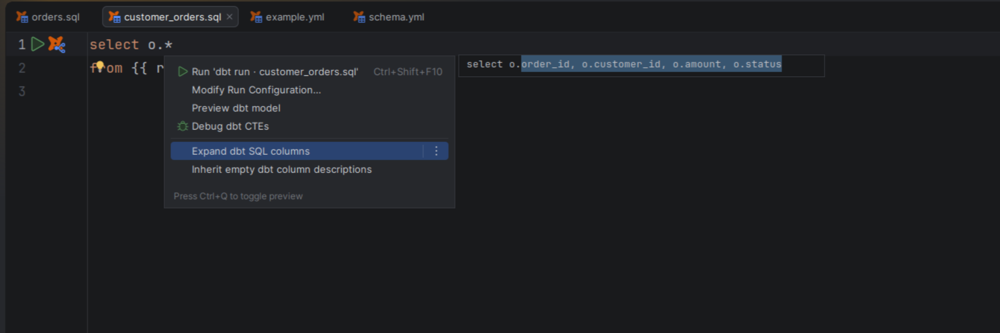

# Expand wildcard columns

[Capability index](README.md) · [User guide](../docs/editing.md#expand-wildcard-columns)

Replace a SQL wildcard with an explicit projection that can be reviewed before applying.

## Contract

- **Inputs:** `*` or a relation-qualified wildcard and a complete, unambiguous known column list.
- **Output:** an ordered projection preserving qualification and quoting, with a preview and Undo.
- `count(*)` is not a projection expansion.
- Unknown columns, ambiguous aliases and unsupported wildcard modifiers produce an explanation and leave the document unchanged.

## Example

For known columns `id`, `amount` and `status`:

```sql
select o.* from {{ ref('stg_orders') }} o
```

The proposed replacement is `o.id, o.amount, o.status`. Review it through **Expand dbt SQL columns** before applying.

## Screenshot



Intention preview replaces o.* with the known columns.

## Interactions

Uses the same known columns as [SQL completion](completion.md). It does not query the warehouse to discover missing columns.
