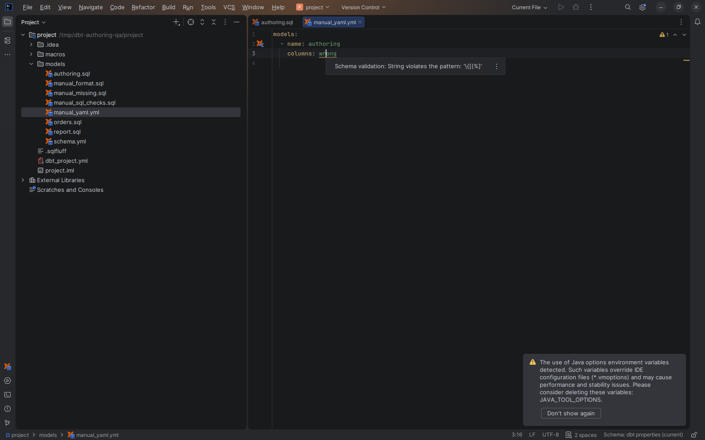

# YAML completion and validation

[Capability index](README.md) · [User guide](../docs/editing.md#editor-warnings)

Help author dbt project, dependency, selector and resource-property YAML offline.

## Contract

- **Inputs:** a recognized dbt YAML file and its effective engine/version.
- **Outputs:** key/value completion, hover descriptions and structural diagnostics.
- Supported keys follow the [compatibility rules](../docs/configuration.md#engine-and-version).
- Jinja values and custom adapter configuration are accepted; structural checks do not evaluate Jinja or validate warehouse credentials.
- Reference-bearing values use [navigation](navigation.md), rather than treating every YAML string as a resource reference.

## Example

In a resource property entry:

```yaml
models:
  - name: orders
    config:
      materialized: table
```

Key completion helps fill `materialized`; an invalid value for a known constrained key receives a structural warning.

## Screenshot


Native YAML key completion in a resource property file.



Structural YAML diagnostic for an invalid known value.

## Interactions

[Completion](completion.md) owns dbt expression and SQL name suggestions. Settings and file schemas are described in [Configuration](../docs/configuration.md).
